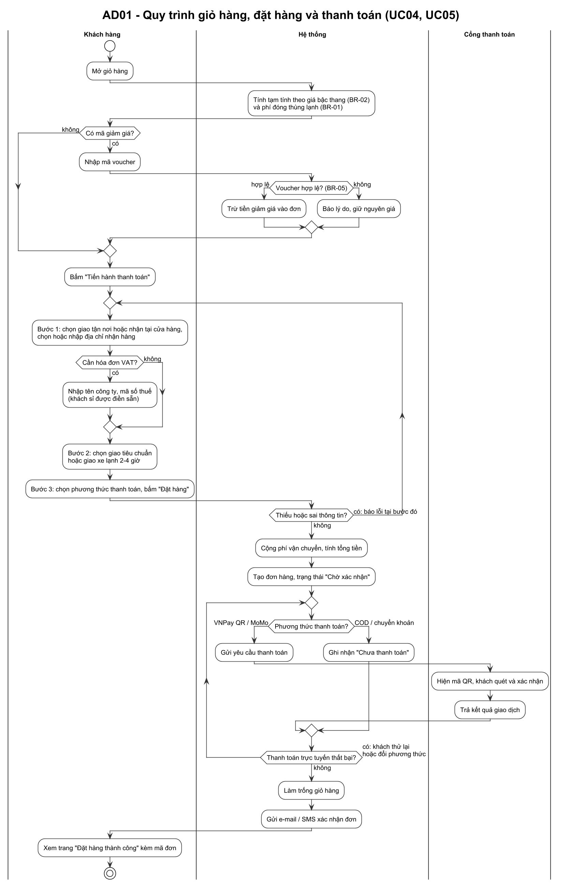
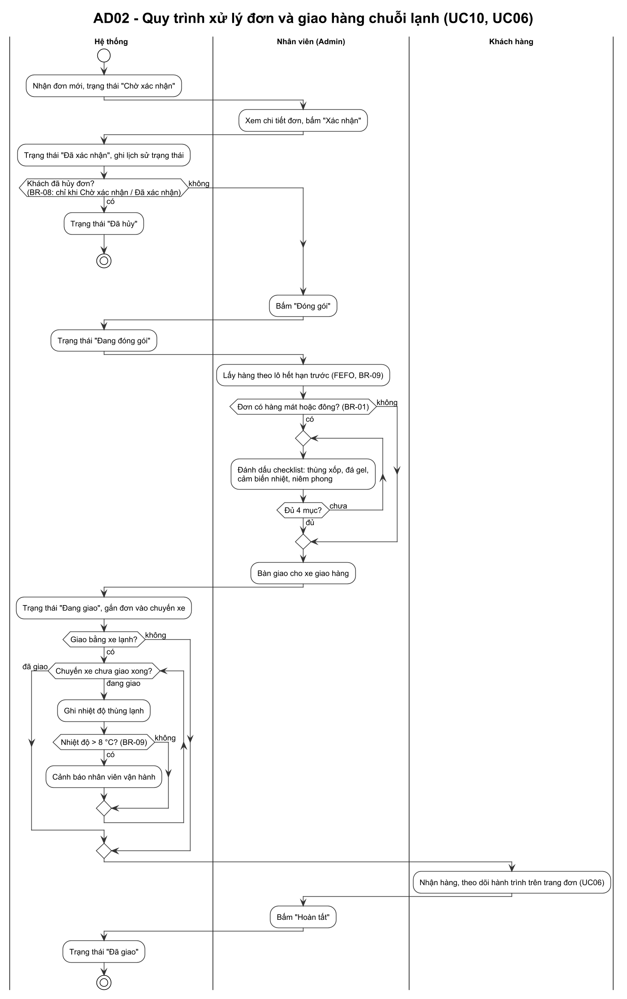
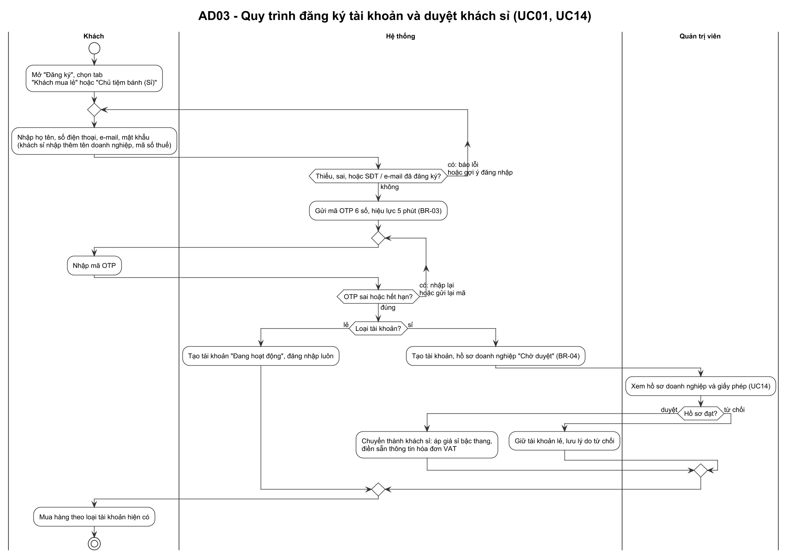

# 🔄 SƠ ĐỒ HOẠT ĐỘNG (ACTIVITY DIAGRAMS)

> **Đề tài:** Topic 1 — Hệ thống mua sắm nguyên liệu và thiết bị làm bánh trực tuyến (Gia Hòa Phát Bakery Supply)
> **Khớp với:** SRS_BakeCraft_v1.0 (luồng chính và luồng thay thế của use case, quy tắc BR-01–BR-09)
> **Mã nguồn sơ đồ:** [`assignment2/diagrams/AD*.puml`](../../assignment2/diagrams) (PlantUML)

Ba quy trình nghiệp vụ cốt lõi, mỗi sơ đồ chia làn (swimlane) theo người hoặc hệ thống thực hiện từng bước. Hình thoi là điểm rẽ nhánh hoặc gộp nhánh; vòng quay lại là bước được làm lại cho tới khi đạt điều kiện.

| Mã | Quy trình | Use case | Quy tắc nghiệp vụ |
| :---: | :--- | :--- | :--- |
| AD01 | Giỏ hàng, đặt hàng và thanh toán | UC04, UC05 | BR-01, BR-02, BR-05 |
| AD02 | Xử lý đơn và giao hàng chuỗi lạnh | UC10, UC06 | BR-01, BR-08, BR-09 |
| AD03 | Đăng ký tài khoản và duyệt khách sỉ | UC01, UC14 | BR-03, BR-04 |

## AD01 — Giỏ hàng, đặt hàng và thanh toán

Giỏ hàng tự áp giá sỉ bậc thang và phí đóng thùng lạnh. Voucher chỉ được trừ khi hợp lệ. Thanh toán qua 3 bước và chỉ tạo đơn khi đủ thông tin. Nếu thanh toán trực tuyến thất bại, khách được thử lại hoặc đổi phương thức (luồng A2 của UC05).

## AD02 — Xử lý đơn và giao hàng chuỗi lạnh

Đơn đi theo đúng thứ tự trạng thái của BR-08. Khách chỉ hủy được khi đơn còn "Chờ xác nhận" hoặc "Đã xác nhận". Kho lấy hàng theo lô hết hạn trước (FEFO). Đơn có hàng mát hoặc đông phải đánh dấu đủ 4 mục đóng thùng lạnh trước khi bàn giao. Trong lúc giao, nhiệt độ thùng trên 8 °C sẽ phát cảnh báo.

## AD03 — Đăng ký tài khoản và duyệt khách sỉ

Mọi tài khoản mới đều phải xác thực OTP (6 số, hiệu lực 5 phút). Tài khoản lẻ dùng được ngay. Tài khoản sỉ ở trạng thái "Chờ duyệt" cho tới khi quản trị viên duyệt hồ sơ doanh nghiệp, sau đó mới được áp giá sỉ và điền sẵn hóa đơn VAT.

