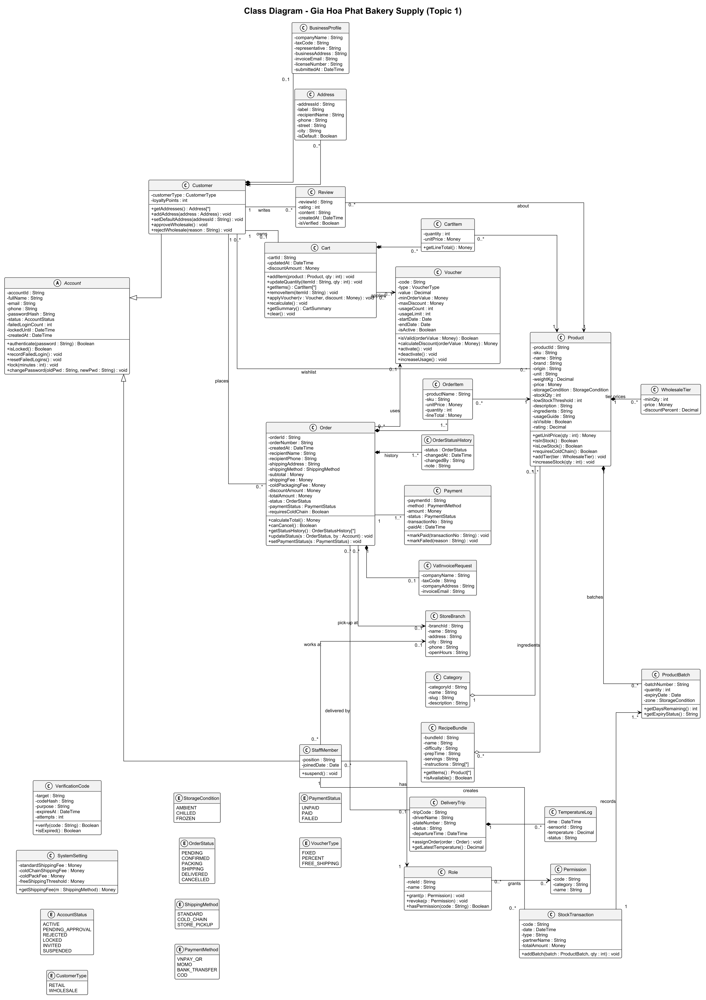
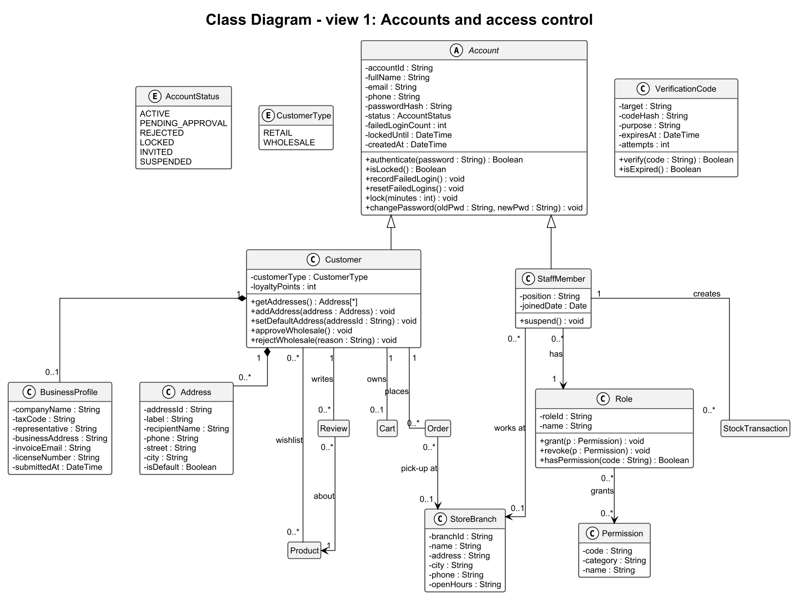
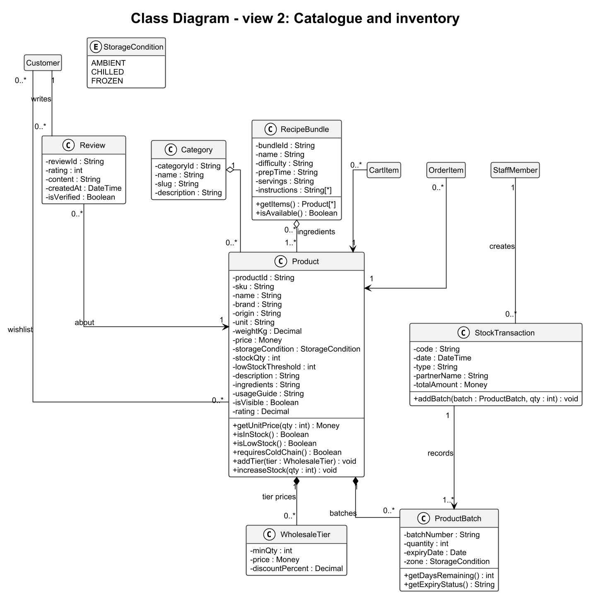
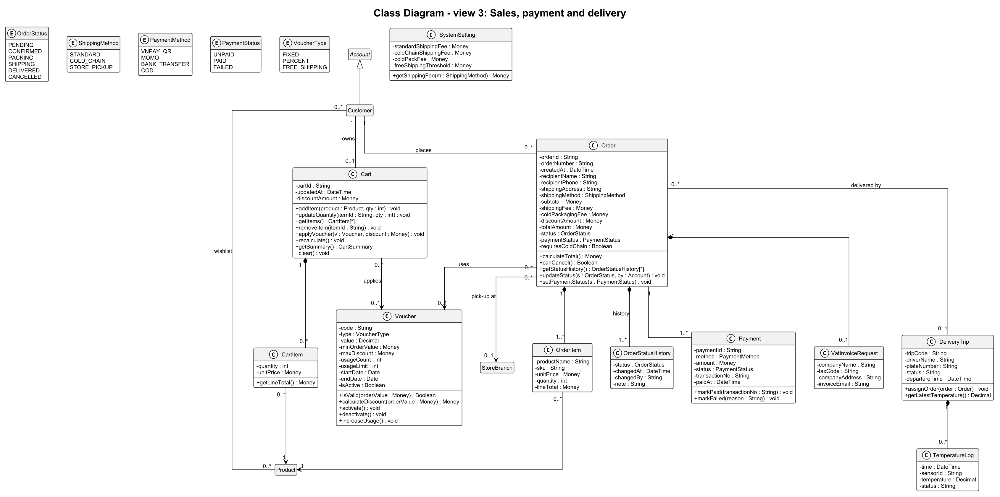

# 🏛️ MÔ HÌNH MIỀN (DOMAIN MODEL / CLASS DIAGRAM)

> **Đề tài:** Topic 1 — Hệ thống mua sắm nguyên liệu và thiết bị làm bánh trực tuyến (Gia Hòa Phát Bakery Supply)
> **Khớp với:** SRS_BakeCraft_v1.0 (UC01–UC15, BR-01–BR-09) và kiểu dữ liệu của prototype (`client/src/types`, `client/src/mocks`)
> **Mã nguồn sơ đồ:** [`assignment2/diagrams/Class_Diagram.puml`](../../assignment2/diagrams/Class_Diagram.puml) (PlantUML). Ba hình theo phân hệ được sinh tự động từ tệp này bằng `assignment2/tools/build.py`.

Sơ đồ lớp mức phân tích: chỉ gồm các lớp thực thể (entity) của bài toán, thuộc tính, thao tác nghiệp vụ và quan hệ. Các lớp giao diện (boundary) và điều khiển (control) chỉ xuất hiện trong [sơ đồ trình tự](sequence_diagrams.md).

## 1. Sơ đồ lớp đầy đủ

## 2. Sơ đồ theo phân hệ

Ba hình dưới đây vẽ lại các lớp trên ở cỡ lớn hơn. Lớp của phân hệ khác chỉ hiện tên để vẫn thấy được quan hệ giữa các phân hệ.

### 2.1 Tài khoản và phân quyền

### 2.2 Danh mục sản phẩm và kho

### 2.3 Bán hàng, thanh toán và giao hàng

## 3. Các lớp chính

| Phân hệ | Lớp | Vai trò |
| :--- | :--- | :--- |
| Tài khoản | `Account` (trừu tượng) | Dữ liệu đăng nhập chung và quy tắc khóa tài khoản; lớp cha của `Customer` và `StaffMember` |
| | `Customer`, `Address`, `BusinessProfile` | Khách lẻ hoặc khách sỉ; sổ địa chỉ; hồ sơ doanh nghiệp chờ duyệt |
| | `StaffMember`, `Role`, `Permission`, `StoreBranch` | Nhân viên GHP, vai trò, ma trận phân quyền, cửa hàng làm việc |
| | `VerificationCode` | Mã OTP 6 số khi đăng ký |
| Danh mục và kho | `Category`, `Product`, `WholesaleTier` | Sản phẩm (nguyên liệu, thiết bị) theo danh mục, có bảng giá sỉ bậc thang |
| | `ProductBatch`, `StockTransaction` | Lô hàng có hạn dùng (xuất theo FEFO) và phiếu nhập, xuất kho |
| | `RecipeBundle`, `Review` | Combo công thức làm bánh; đánh giá sản phẩm |
| Bán hàng và giao hàng | `Cart`, `CartItem`, `Voucher` | Giỏ hàng, dòng giỏ, mã giảm giá |
| | `Order`, `OrderItem`, `OrderStatusHistory`, `VatInvoiceRequest` | Đơn hàng, dòng đơn (lưu lại giá lúc mua), lịch sử trạng thái, yêu cầu hóa đơn VAT |
| | `Payment` | Lần thanh toán của đơn; một đơn có thể có nhiều lần nếu lần đầu thất bại |
| | `DeliveryTrip`, `TemperatureLog` | Chuyến xe lạnh và nhật ký nhiệt độ thùng |
| | `SystemSetting` | Phí vận chuyển, phí đóng thùng lạnh, ngưỡng miễn phí vận chuyển |

**Kiểu liệt kê:** `AccountStatus`, `CustomerType`, `StorageCondition`, `OrderStatus`, `ShippingMethod`, `PaymentMethod`, `PaymentStatus`, `VoucherType`.

## 4. Quy tắc nghiệp vụ trong mô hình

| Quy tắc (SRS) | Thể hiện ở |
| :--- | :--- |
| BR-01 Chuỗi lạnh | `Product.requiresColdChain()`, `Cart.recalculate()` (phí đóng thùng lạnh), `Order.coldPackagingFee`, `DeliveryTrip` / `TemperatureLog` |
| BR-02 Giá sỉ bậc thang | `WholesaleTier`, `Product.getUnitPrice(qty)` |
| BR-03 OTP và khóa tài khoản | `VerificationCode.verify()`, `Account.recordFailedLogin()`, `Account.lock()` |
| BR-04 Tài khoản sỉ | `BusinessProfile`, `Customer.approveWholesale()` / `rejectWholesale()` |
| BR-05 Voucher | `Voucher.isValid(orderValue)`, `Voucher.calculateDiscount()` |
| BR-06 Combo còn hàng | `RecipeBundle.isAvailable()` |
| BR-08 Luồng trạng thái đơn | `OrderStatus`, `Order.canCancel()`, `Order.updateStatus()`, `OrderStatusHistory` |
| BR-09 FEFO và cảnh báo hạn dùng | `ProductBatch.getDaysRemaining()`, `ProductBatch.getExpiryStatus()` |

## 5. Quy ước

- Thuộc tính để `-` (private), thao tác để `+` (public). Kiểu `Money` là số tiền VND (BR-07).
- Các thao tác tìm kiếm trong sơ đồ trình tự (`find…`, `search…`, `exists…`, `count…`, `sum…`) là truy vấn cấp lớp, đọc đối tượng đã lưu, nên không lặp lại trong sơ đồ lớp.
- Mọi thông điệp gửi tới lớp thực thể trong 15 sơ đồ trình tự đều là thao tác có trong sơ đồ này.
