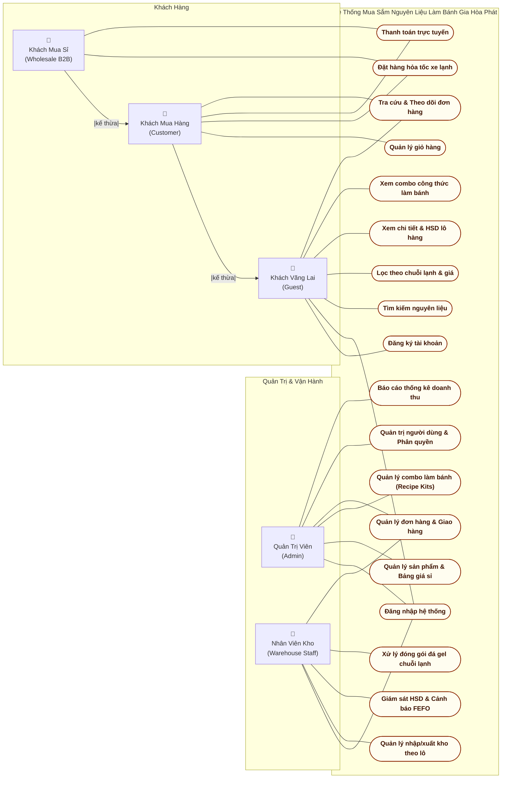
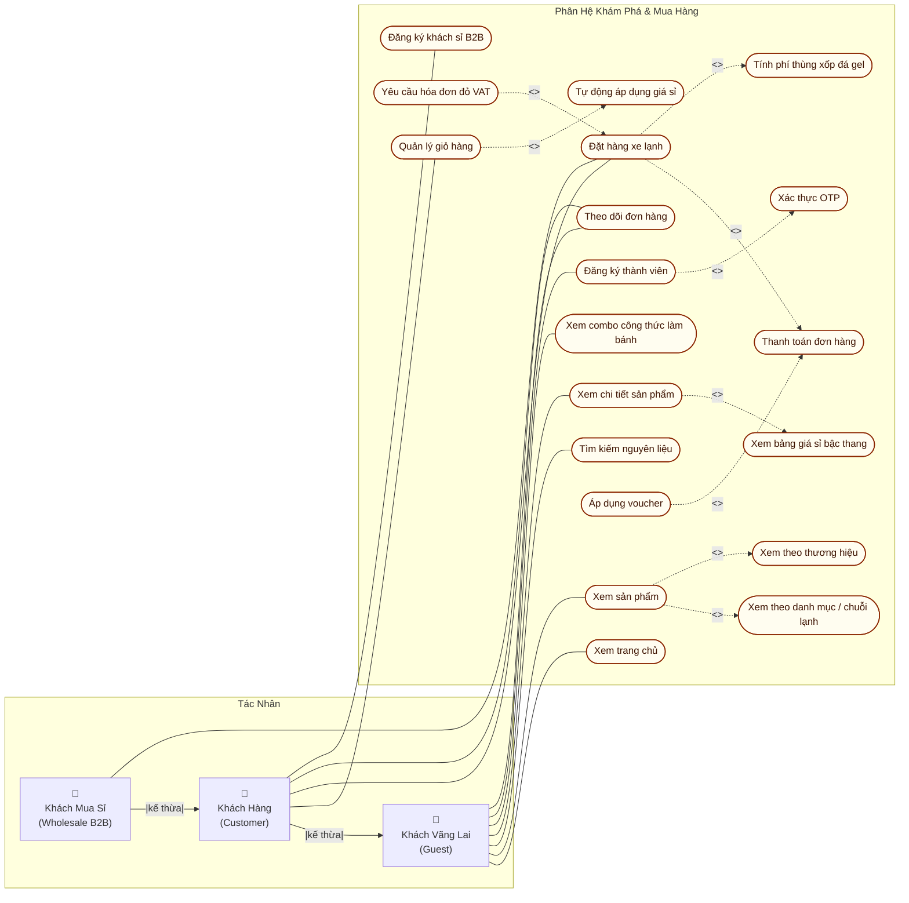
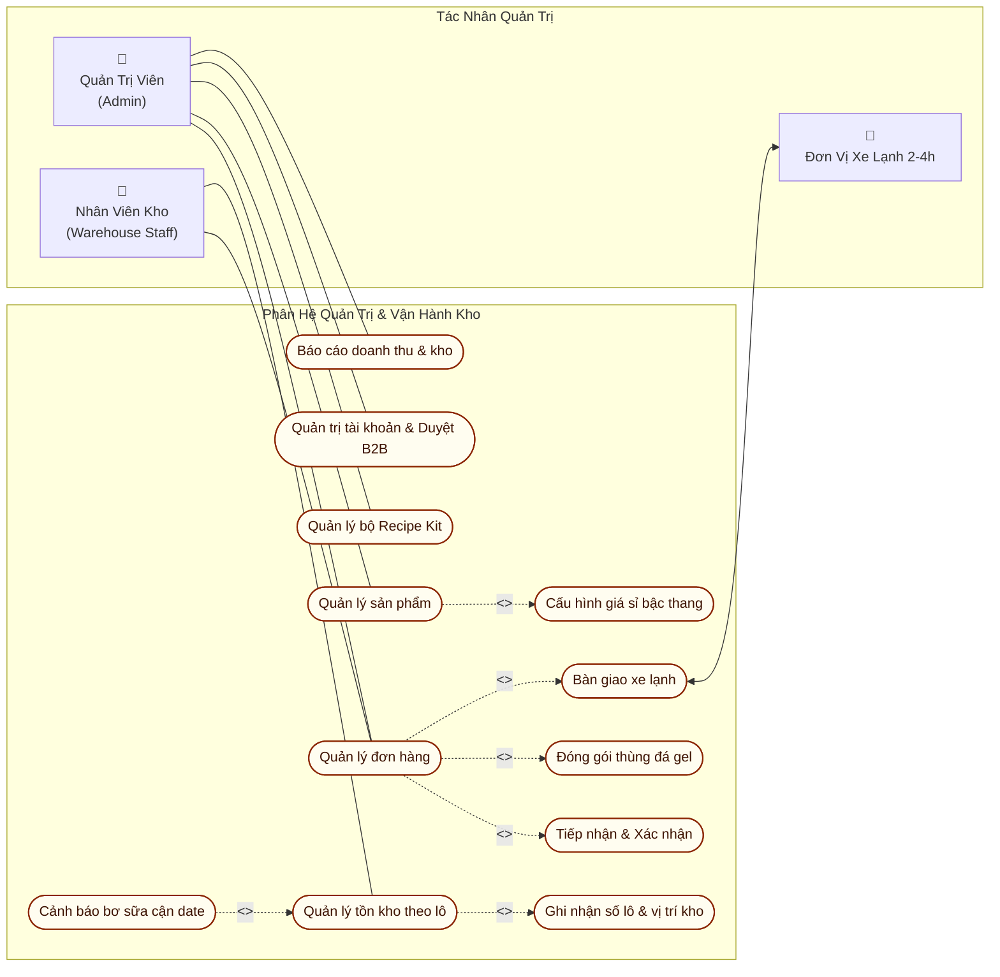
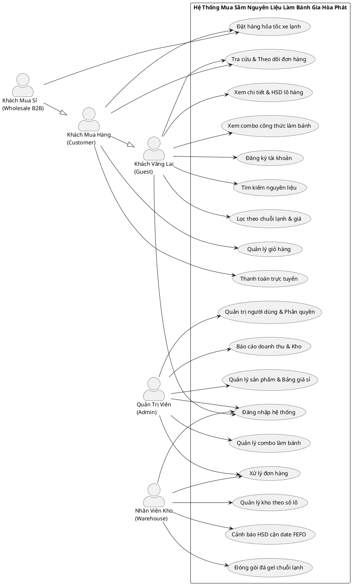

# 📊 SƠ ĐỒ USE CASE DỰ ÁN (USE CASE DIAGRAMS)

> **Môn học:** SWR302 — Software Requirements Engineering  
> **Đề tài:** Topic 1 — Hệ Thống Mua Sắm Nguyên Liệu & Thiết Bị Làm Bánh Trực Tuyến (**Gia Hoa Phat Bakery Supply**)  
> **Định dạng:** Chuẩn giáo trình kỹ nghệ phần mềm Việt Nam & Quốc tế (UML 2.5 / Cockburn Use Case Model)  
> **Xem trực tiếp trên Web:** [http://localhost:5500/use_case_viewer.html](http://localhost:5500/use_case_viewer.html)

---

## 2.1 BIỂU ĐỒ USE CASE TỔNG QUAN (SYSTEM OVERVIEW USE CASE DIAGRAM)

Mô hình bố cục 2 phía kinh điển theo chuẩn giáo trình:
- **Phía bên trái:** Tác nhân Quản trị & Vận hành (`Admin / Quản Trị Viên`, `Nhân Viên Kho`).
- **Phía bên phải:** Tác nhân Người dùng (`Khách Vãng Lai / Guest`, `Khách Mua Hàng / Customer`, `Khách Mua Sỉ / Wholesale B2B`) có quan hệ kế thừa (`Generalization ▲`).
- **Ở giữa:** Khung ranh giới hệ thống (*System Boundary*) chứa cột các Use Case hình Oval xếp dọc thẳng hàng, ngăn nắp.

---

## 2.2 BIỂU ĐỒ USE CASE PHÂN RÃ (DECOMPOSED USE CASE DIAGRAMS)

### 2.2.1 Phân Rã 1: Phân Hệ Khách Hàng & Mua Sắm (Customer & Shopping)
Thể hiện chi tiết các quan hệ `<<include>>` (Bao hàm bắt buộc) và `<<extend>>` (Mở rộng có điều kiện) trong quá trình tìm kiếm, quản lý giỏ hàng và đặt hàng nguyên liệu làm bánh.

---

### 2.2.2 Phân Rã 2: Phân Hệ Quản Trị Cửa Hàng & Kho Vận (Admin & Warehouse)
Thể hiện luồng quản lý đơn hàng chuỗi lạnh và quản trị kho bơ sữa theo hạn sử dụng FEFO.

---

## 2.3 MÃ PLANTUML CHUẨN ĐỂ IMPORT VÀO DRAW.IO / WORD

Sinh viên có thể sao chép đoạn mã PlantUML dưới đây vào **Draw.io** (`Arrange -> Insert -> Advanced -> PlantUML`) hoặc công cụ **PlantText.com** để xuất ra sơ đồ hình người que chuẩn 100%:

